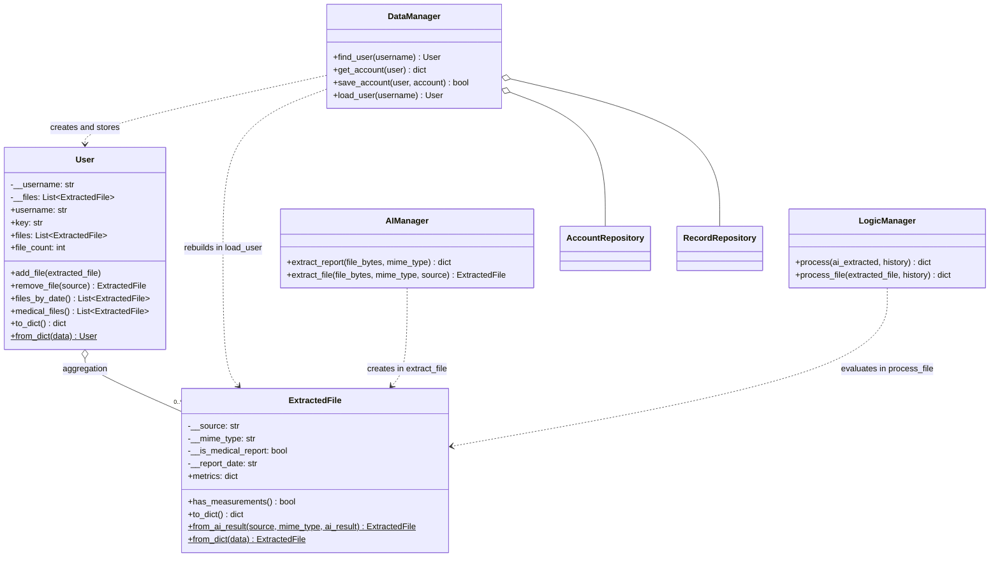
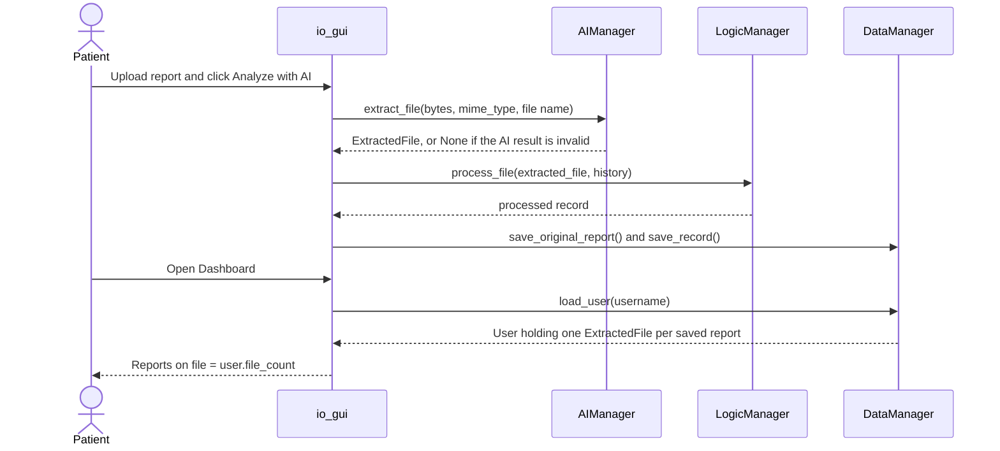

# PASSAY — AI-Assisted Personal Health History & Consultation Preparation

**INF1103 P8 Team 2 | Phase 2**

PASSAY is a Python and Streamlit application that helps users organise medical reports, track health measurements, maintain personal health information, and prepare summaries for medical consultations.

The application uses Google Gemini to extract measurements from uploaded medical reports and applies rule-based logic to identify notable findings and changes. PASSAY is a consultation-preparation tool, not a diagnostic system.

## 1. Main Features

### Medical Report Analysis
- Upload one PDF, one image, or multiple image pages belonging to the same medical report.
- Supported formats: PDF, PNG, JPG and JPEG.
- Maximum upload size: 30 MB for a PDF and 10 MB per image.
- Extract heart rate, systolic/diastolic blood pressure and blood glucose through Google Gemini.
- Validate structured AI output and verify extracted measurements against the source report.
- Process verified values using deterministic health rules.
- Store processed records and preserve original uploaded reports.

### Health History and Trends
- View historical medical-report records.
- Display recorded measurements graphically.
- Identify notable trends, changes and findings.
- Prepare consultation summaries without providing diagnoses or treatment recommendations.

### Medical Profile — Phase 2 New Feature
- Record medications and dosages, blood group, allergies, emergency contacts and hereditary illnesses.
- Validate and save profile information.
- Generate downloadable Medical Profile PDFs.
- Access previously generated Medical Profile PDFs.

### My Vitals — Additional Phase 2 Enhancement
- Manually log heart rate, blood pressure and blood glucose measurements.
- Enter measurement date, time and optional notes.
- Validate measurements before saving.
- View self-logged measurement history and trends.
- Include notable self-logged findings in a separate consultation-report section.

Self-logged vitals are stored separately from AI-extracted medical-report records and do not require Gemini extraction.

### Account Management
- Account registration and password-based login.
- Salted, hashed password storage.
- Optional four-digit PIN login.
- User-specific access to stored records and profiles.

## 2. Object-Oriented Architecture

PASSAY retains the four core manager responsibilities and uses supporting classes for separation of concerns.

| Manager | Responsibility |
|---|---|
| **I/O Manager** | User input/output abstraction, input validation, interfaces and formatting |
| **AI Manager** | AI extraction, response parsing, schema validation, source verification and retry orchestration |
| **Logic Manager** | Measurement validation, classification, trend detection, notable findings and safety rules |
| **Data Manager** | Saving, retrieving and managing health records, accounts, profiles and report archives |

The Streamlit GUI provides the interactive presentation layer and invokes application services. The I/O Manager additionally contains reusable input/output abstractions, including console-oriented implementations.

### Supporting Packages

- `ai_layer/` — AI client interface, Gemini implementation, mock client, tasks, prompts, parser and retries.
- `logic_layer/` — Measurement specifications, classification rules, safety guardrails, manual-vitals validation and medical-profile validation.
- `io_layer/` — User interface abstractions, input validators, formatters and menu components.
- `data_layer/` — Repository interfaces, JSON/SQLite implementations, and file/archive stores.
- `io_gui/` — Streamlit presentation layer.
- `tests/` — Automated tests covering manager behaviour and application logic.

### OOP Concepts Demonstrated

- **Encapsulation:** Internal class state and implementation details are managed within objects.
- **Abstraction:** Interfaces and abstract base classes define reusable contracts.
- **Inheritance:** Concrete clients, rules, validators and repositories extend common abstractions.
- **Polymorphism:** Implementations can be substituted through shared interfaces.
- **Association, aggregation and composition:** Managers collaborate with injected dependencies and owned components.

### SOLID Principles

- **Single Responsibility Principle (SRP):** AI communication, domain rules, data persistence and input/output have distinct responsibilities.
- **Open/Closed Principle (OCP):** Additional rules, validators and repository implementations can be introduced through existing abstractions.
- **Liskov Substitution Principle (LSP):** Compatible implementations of shared interfaces can replace one another without changing the consuming code.

Examples include `AIClient` with `GeminiClient` and `MockAIClient`, rule subclasses used by `LogicManager`, and JSON/SQLite implementations of repository contracts.

### Domain Classes: `User` and `ExtractedFile`

Two domain classes carry data between the four managers:

| Class | File | Represents |
|---|---|---|
| `User` | `user.py` | A registered user. Read-only, case-insensitive identity (`username`, `key`) and the user's uploaded files. |
| `ExtractedFile` | `file.py` | One uploaded report and its validated AI extraction (classification, metrics, report date). Rejects blank sources, invalid dates and negative or non-finite readings. |

Where the application uses them:

| Workflow | Code | What happens |
|---|---|---|
| Registration | `io_gui.create_temporary_account()` | Creates a `User`; checks duplicates with `DataManager.find_user()`; saves with `DataManager.save_account(user, credentials)`. |
| Password login | `io_gui.authenticate_temporary_account()` | Returns the authenticated `User`; the session uses `user.username`. |
| Quick-login PIN | `io_gui.user_has_pin()`, `set_user_pin()`, `remove_user_pin()`, `authenticate_with_pin()` | Look up the `User` with `find_user()`; read and write one account with `get_account()` / `save_account()`. |
| Report upload | `io_gui.show_upload()` | `AIManager.extract_file()` returns an `ExtractedFile` (or `None` if the AI result is invalid); `LogicManager.process_file()` evaluates it. |
| Date re-detection | `io_gui.show_history()` | `AIManager.extract_file()` re-reads the archived original; the suggested date is `ExtractedFile.report_date`. |
| Dashboard | `io_gui.show_dashboard()` | `DataManager.load_user()` rebuilds the `User` with one `ExtractedFile` per saved report; the "Reports on file" tile shows `user.file_count`. |

Consultation-summary PDFs are generated by the application rather than uploaded and extracted, so they are not modelled as `ExtractedFile`.



Report upload and dashboard workflow:



## 3. Data Storage and Database Integration

**SQLite database integration is the Phase 2 advanced feature.**

The primary database is `data/app.db`, which stores all application data: health records, user accounts, self-logged vitals, medical profiles and the metadata for every uploaded report and generated PDF.

Only the files themselves (uploaded medical reports and generated PDFs) are kept on disk, in the `data/` folders.

Key storage components include:

- `SqliteRecordRepository` — processed health records.
- `SqliteAccountRepository` — account data.
- `SqliteListStore` — SQLite-backed metadata collections.
- `OriginalReportArchive` — uploaded report files and associated metadata.
- `ConsultationPdfArchive` — consultation PDF files and metadata.
- `SqliteMedicalProfileStore` — user medical profiles (one row per user).
- `MedicalProfilePdfArchive` — generated Medical Profile PDFs.
- `SqliteVitalsRepository` — manually logged vital-sign entries.

Repository abstractions separate business logic from persistence implementation.

The project also includes `migrate_json_to_sqlite.py` to migrate supported legacy JSON records and metadata into SQLite without intentionally overwriting existing database data.

## 4. AI Processing Workflow

The core medical-report workflow is:

1. The user uploads a supported medical report through Streamlit.
2. Input and file validation are performed.
3. The AI Manager sends the report and extraction prompt to Gemini.
4. The AI response is parsed and validated against the expected structured format.
5. Extracted values undergo source verification. Unsupported values are excluded from the verified result.
6. The Logic Manager applies deterministic rules and analyses relevant history.
7. The Data Manager persists the processed record and report information.
8. The GUI presents the record, trends and consultation-preparation information.

The AI Manager supports model fallback and error handling for unavailable services. If AI processing cannot complete, the application must not invent extracted measurements.

## 5. Setup Instructions

### Requirements

- Python 3.11 or later
- pip
- Internet access for live Gemini processing
- Gemini API key
- Docker for container execution and testing

### Install Dependencies

From the project root:

```bash
python -m venv venv
```

Activate the virtual environment.

macOS/Linux:

```bash
source venv/bin/activate
```

Windows:

```bat
venv\Scripts\activate
```

Install packages:

```bash
python -m pip install -r requirements.txt
```

### Configure Gemini

Copy `.env.example` to `.env` in the project root.

Inside `.env`, configure:

```text
GEMINI_API_KEY=YOUR_REAL_API_KEY
```

Get a key from https://aistudio.google.com/apikey.

**Never commit the actual API key or `.env` file to GitHub.**

### Run the Application Locally

```bash
python -m streamlit run io_gui/io_gui.py
```

Open the local URL displayed in the terminal, normally:

http://localhost:8501

## 6. Docker

Build the image from the project root:

```bash
docker build -t passay .
```

Run the application:

```bash
docker run --rm -p 8501:8501 --env-file .env -v "${PWD}/data:/app/data" passay
```

Open:

http://localhost:8501

The environment file supplies the Gemini API key at runtime. The mounted `data/` directory allows local application data to persist across container runs.

## 7. Automated Testing

PASSAY uses `pytest`.

Run the complete test suite locally:

```bash
python -m pytest -q
```

Run the tests inside Docker:

```bash
docker run --rm passay python -m pytest -q
```

The automated tests include mock AI responses and do not require a live Gemini API key.

Tests cover AI response handling, validation, source verification, retry behaviour, domain rules, input/output components and data management.

Tests for the `User` and `ExtractedFile` integration:

| File | Proves |
|---|---|
| `tests/test_user.py`, `tests/test_file.py` | Each class on its own: validation, equality, encapsulation, conversion. |
| `tests/test_user_file_integration.py` | The managers use the classes: account methods keyed by `User`, `AIManager.extract_file()`, `LogicManager.process_file()` (identical results to `process()`), and a full register, upload and `load_user()` workflow. |
| `tests/test_gui_user_workflow.py` | The real Streamlit pages (Register, Login, PIN, Upload, Dashboard), driven with Streamlit's `AppTest` on temporary storage and a mock AI, pass `User` and `ExtractedFile` objects through the managers. |

```bash
python -m pytest tests/test_user_file_integration.py tests/test_gui_user_workflow.py -v
```

## 8. Continuous Integration

GitHub Actions runs the PASSAY CI workflow defined in:

```text
.github/workflows/ci.yml
```

For pushes and pull requests, the workflow:

1. Checks out the repository.
2. Builds the Docker image.
3. Runs the automated pytest suite inside Docker.

This verifies that the application dependencies can be installed and that the automated tests run in a reproducible container environment.

## 9. Safety and Limitations

PASSAY is intended for health-record organisation and consultation preparation only.

- It does not provide medical diagnoses or prescribe treatment.
- AI outputs may be incomplete or inaccurate, so extracted values undergo validation and verification.
- Missing or unsupported measurements must not be fabricated.
- Rule-based alerts are informational and should not replace professional medical assessment.
- Live AI processing depends on Gemini API availability, quotas and configured model access.
- The application is an educational prototype using local storage, not a production clinical records system.

## 10. Phase 2 Deliverables

The project demonstrates:

- Object-oriented refactoring of the four manager responsibilities.
- Abstract classes, interfaces, inheritance, polymorphism, encapsulation and object relationships.
- SRP, OCP and LSP through reusable classes.
- Medical Profile as a meaningful new feature.
- My Vitals and PIN login as additional enhancements.
- SQLite database integration as an advanced feature.
- Automated testing with mocked AI interactions.
- Docker-based application execution and testing.
- GitHub Actions continuous integration.

**Project:** INF1103 P8 Team 2  
**Application:** PASSAY  
**Framework:** Python, Streamlit  
**AI service:** Google Gemini  
**Persistence:** SQLite and local file storage